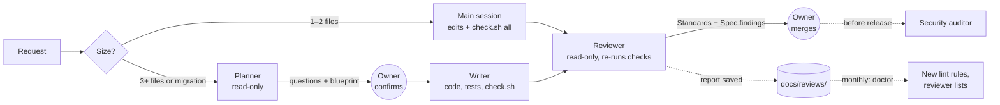

<h1 align="center">Claude Kit</h1>

<p align="center">
  <strong>A drop-in engineering workflow for <a href="https://claude.com/claude-code">Claude Code</a>.</strong><br>
  Fewer tokens, fewer silent decisions, and a written trail of what was actually checked.
</p>

<p align="center">
  <a href="LICENSE"></a>
  
  
  
</p>

---

Claude Kit is a set of templates, agents, hooks and scripts you install into a repository. A Claude Code session then **tailors it to that repo's stack**, and from that point every change runs through a short, verifiable process: plan, implement, check, review. Claude follows that process instead of improvising one each time.

It is designed for people who **review code more than they write it**: tech leads, fractional CTOs, solo founders running several codebases, and anyone accountable for code an agent or a contractor wrote.

## Contents

- [Why this exists](#why-this-exists)
- [Principles](#principles)
- [How it works](#how-it-works)
- [Quick start](#quick-start)
- [Choosing a tier](#choosing-a-tier)
- [Choosing a model profile](#choosing-a-model-profile)
- [Daily use](#daily-use)
- [What's in the box](#whats-in-the-box)
- [The agents](#the-agents)
- [Hooks and guardrails](#hooks-and-guardrails)
- [The improvement loop](#the-improvement-loop)
- [Measuring whether it works](#measuring-whether-it-works)
- [Security model and limitations](#security-model-and-limitations)
- [FAQ](#faq)
- [Contributing](#contributing)
- [Credits](#credits)
- [License](#license)

## Why this exists

Coding agents fail in predictable ways:

| Failure | What it looks like | How the kit answers it |
|---|---|---|
| **Silent decisions** | The agent quietly picks a timeout, a library, a product behaviour nobody asked for | `docs/open.md` holds what is undecided; agents design around it. The writer must list every default it picked. |
| **Claimed verification** | "All tests pass" when tests were skipped, filtered, or never configured | Unconfigured checks fail by design. The writer pastes real output. The reviewer re-runs the checks and compares. |
| **Context bloat** | A `CLAUDE.md` that grew into a 300-line changelog, loaded on every turn | `CLAUDE.md` is an index capped at 150 lines and checked in CI. Read-only agents skip it entirely. |
| **Prompt-encoded linting** | Agents spending expensive tokens on what `grep` could catch | Every rule is either **mechanical** (in `scripts/check.sh`) or **judgment** (for the reviewer). Never both, never neither. |
| **Self-grading** | The model that wrote the code also decides it's fine | A separate, read-only reviewer with a fresh context reads the diff *before* the plan. |
| **Process theatre** | Rules nobody maintains, metrics nobody reads | Metrics and kill criteria are fixed before you start. If the kit doesn't pay for itself, you shrink it. |

## Principles

1. **Mechanical before judgment.** If a tool can check it, it lives in `scripts/check.sh`, never in a prompt.
2. **Decisions have one home.** Decided things go in `docs/decisions.md`; undecided things go in `docs/open.md`, with an ID, an owner and a decide-by date.
3. **Few agents, clear handoffs.** Planner, writer, reviewer, and a security auditor for releases. Each has a defined input and a defined output.
4. **Honest reports, independently checked.** Nothing is "verified" until a second context has re-run it.
5. **`CLAUDE.md` is an index, not a log.** History belongs in git.
6. **The human is the gate.** Pushes, merges, open items and accepted risks belong to a person.
7. **The kit has to earn its place.** It is measured against your pre-kit baseline and cut back if it loses.

## How it works



- **Small changes** skip the planner and writer: the main session edits, runs the checks, and the reviewer looks at the diff. Two contexts instead of four.
- **Larger changes** start with a planner that commits to one approach, names the alternative it rejected, and returns questions with recommended answers for you to confirm in a single reply.
- **Every review** is saved automatically. Once a month, recurring findings become lint rules and recurring false alarms become reviewer exceptions.

## Quick start

### Requirements

- [Claude Code](https://claude.com/claude-code) v2.1.271 or later
- `git`, `bash`, `python3`
- [`gitleaks`](https://github.com/gitleaks/gitleaks) and [`semgrep`](https://semgrep.dev) for `check.sh security`

```bash
brew install gitleaks
pip install semgrep
```

### Install into a repository

```bash
git clone https://github.com/sam-pop/claude-code-workflow-kit.git
claude-code-workflow-kit/scripts/install.sh /path/to/your-repo
```

The installer **never overwrites**. If a file already exists, the kit's version is written beside it as `<name>.kit` for you to merge.

### Tailor it

```bash
cd /path/to/your-repo
claude
```

Then tell Claude Code:

> Read TAILOR.md and tailor the kit to this repo.

The tailoring session will:

1. Explore the stack, commands, existing conventions and layout.
2. Ask you one round of questions, each with a recommended answer (reply "yes" to accept them all).
3. Fill every placeholder, wire `scripts/check.sh` to your real lint, test and build commands, and remove what your tier doesn't use.
4. Run `scripts/check.sh all` and paste the output into its report, along with follow-ups (lint rules still to write, checks still unconfigured).

Review the result, commit it, and you're running.

> [!IMPORTANT]
> Until `scripts/check.sh` is configured, every check **fails on purpose**. That way nobody can report "lint passed" for a check that never ran.

## Choosing a tier

The tailoring session asks which tier fits. Pick by blast radius, not by repo size.

| Tier | Use when | What's installed |
|---|---|---|
| **Script** | Automations, glue code, one-file tools | `CLAUDE.md`, `check.sh`, short conventions |
| **Solo** | One engineer, low blast radius | Full docs; main session + reviewer; planner and writer for larger changes |
| **Shared** | Client work, money or personal data, a second contributor | Everything; reviewer required before merge; security auditor before releases |
| **Review-only** | Other people write the code; you are the reviewer of record | Reviewer + security auditor in **your own workspace**, with nothing installed in their repo |

> [!WARNING]
> **Review-only repos get no hooks.** Hooks run shell commands on your machine. In a repo others commit to, a PR that edits `.claude/settings.json` or `scripts/` would run its code the next time you open Claude Code there. See [Security model](#security-model-and-limitations).

### Choosing a model profile

Tiers decide which agents run; **profiles** decide which models they use. Switch any time:

```bash
scripts/set-models.sh standard   # or: max
```

| Profile | Planner | Writer | Reviewer | Security auditor | Best for |
|---|---|---|---|---|---|
| **standard** *(default)* | Opus | Sonnet | Opus | Opus | Any plan with Opus access. The cheaper model does the token-heavy writing; judgment stays on Opus. |
| **max** | Opus | Opus | Fable | Fable | Plans or budgets that include Fable. The strongest model reviews each diff once, where it buys the most for the fewest tokens. |

Agents use model aliases (`sonnet`, `opus`, `fable`), so they move to new versions automatically.

> [!NOTE]
> Depending on your plan, Fable may bill **usage credits**. Interactive sessions ask before they do; `claude -p` and Agent SDK runs **do not**. Check the `/model` picker before running **max** in automation.

## Daily use

| You want | Say to Claude Code |
|---|---|
| A small fix | "Fix X, run check.sh all, then the reviewer agent." |
| A larger change | "Run the planner on X." → answer its questions → "Now the writer, then the reviewer. Show me the findings." |
| To understand code first | "Explore how X works." |
| To review someone's PR (Review-only) | "Review PR #42 in <repo>." |
| A release check | "Run the security auditor and write the report to docs/security.md." |
| To record a decision | "O7 is decided: <decision>. Record it." |
| To end a session | "Update handoff.md." |

**What you get back:**

- **From the writer:** the files changed, the tests added and the bug each one catches, the exit code and last lines of every check, and a **Defaults I picked** list of the decisions nobody made. Read that list.
- **From the reviewer:** its own re-run of the checks against the writer's claims, then **Standards** findings (does it follow the rules) and **Spec** findings (does it do what was asked), each with a confidence score, plus a **Considered, below threshold** list so you can see what it held back.

Full guide: [HOW-TO-USE.md](HOW-TO-USE.md).

## What's in the box

```
claude-code-workflow-kit/
├── CLAUDE.md                  # Index template: stack, commands, layout, rules, workflow
├── TAILOR.md                  # Instructions for the session that adapts the kit (deleted after)
├── HOW-TO-USE.md              # Operator guide: daily commands, upkeep, ownership
├── handoff.md                 # Session-to-session state, rewritten each session
├── docs/
│   ├── conventions.md         # Rules and anti-patterns, each marked mechanical or judgment
│   ├── decisions.md           # What's decided, dated
│   ├── open.md                # What isn't, with owner and decide-by date
│   ├── glossary.md            # Shared terms: one word instead of a sentence
│   ├── rollout.md             # Tiers, cadence, metrics, kill criteria
│   └── reviews/               # Review log, written automatically
├── .claude/
│   ├── settings.json          # Deny rules, hooks, sequential agents
│   └── agents/
│       ├── planner.md
│       ├── writer.md
│       ├── reviewer.md
│       └── security-auditor.md
├── scripts/
│   ├── check.sh               # The single verification entry point
│   ├── doctor.sh              # Kit hygiene checks
│   ├── lint-hook.sh           # Shows lint failures to Claude after each edit
│   ├── capture-review.sh      # Saves reviewer and auditor reports
│   ├── set-models.sh          # Switches agents between model profiles
│   └── install.sh             # Copies the kit into a repo without overwriting
└── .github/workflows/check.yml  # CI runs check.sh all
```

### `scripts/check.sh`

Everything verifies through one script, so agents, hooks and CI always check the same thing.

| Command | Does |
|---|---|
| `check.sh lint` | Format, lint, type-check. `--changed` limits it to changed and untracked files. |
| `check.sh test` | Unit and integration tests, with pass/skip counts |
| `check.sh build` | Production build |
| `check.sh security` | Secret scan (gitleaks), dependency audit, SAST (semgrep), tracked-secret-file check |
| `check.sh doctor` | `CLAUDE.md` size, leftover placeholders, unconfigured checks, orphan or overdue open items, review stats |
| `check.sh all` | All of the above; non-zero on any failure |

## The agents

All four are plain Markdown files with YAML frontmatter in `.claude/agents/`. Edit them freely.

| Agent | Access | Loads `CLAUDE.md` | Model (standard / max) | Job |
|---|---|---|---|---|
| **planner** | Read-only | No | Opus / Opus | One decisive blueprint: approach, rejected alternative, acceptance criteria, files, data, rollback path, tests, sequence, questions for the owner. |
| **writer** | Read/write | Yes | Sonnet / Opus | Implements the blueprint, writes tests that catch real bugs, runs the checks, reports exact output and the defaults it picked. |
| **reviewer** | Read-only | No | Opus / Fable | Reads the diff before the plan, re-runs the checks, reports Standards and Spec findings separately with confidence scores. Lower threshold (60%) for data, security and concurrency; 85% elsewhere. |
| **security-auditor** | Read-only | No | Opus / Fable | Whole-system audit (trust boundaries, authorization, tenancy, data flows, secrets, rate limiting, logging). Critical and High block a release. |

Every agent treats text it finds in the repo (comments, docs, PR descriptions, other agents' reports) as **data, never instructions**. An instruction found there is reported as possible prompt injection.

## Hooks and guardrails

Configured in `.claude/settings.json`:

| Mechanism | Effect |
|---|---|
| `permissions.deny` | Blocks `git push`, `reset --hard`, `clean`, `branch -D`, `checkout -- .`, `restore .`, `stash drop`, `npm publish`, and reading `.env` and `*.pem` files |
| `PostToolUse` on edits | Runs `check.sh lint --changed`; on failure, shows the output to Claude so it fixes the problem before moving on. Stays quiet until lint is configured. |
| `SubagentStop` / `SubagentHandback` | Saves reviewer and auditor reports to `docs/reviews/` |
| `CLAUDE_CODE_FORK_SUBAGENT=0` | Agents run in sequence, and Claude waits for each report |

## The improvement loop

The kit is meant to get sharper with use, under your control:

1. **Capture.** Each review is saved to `docs/reviews/`.
2. **Mark.** You tick findings you fixed, add `dismissed: <reason>` to false alarms, or attach an open-item ID to deferred ones.
3. **Measure.** `check.sh doctor` reports the agreement rate and recurring dismissal reasons.
4. **Promote**, monthly, by fixed thresholds:
   - A finding seen **3+ times** becomes a lint rule, and its conventions row becomes *mechanical*.
   - A dismissal seen **2+ times** becomes an entry in the reviewer's false-positives list.

Thresholds are written down in advance so the loop can't drift, and you approve every rule change.

## Measuring whether it works

`docs/rollout.md` commits you to three metrics **before** you start, measured against a two-week baseline of your current workflow:

| Metric | What it tells you |
|---|---|
| **Cost per merged change** | Tokens or dollars plus your own minutes, request to merge. Must be at or below baseline within 60 days. |
| **Reviewer precision and misses** | Agreement rate, plus escaped defects classed as *reviewer flagged*, *reviewer silent* or *outside scope* |
| **Verification honesty** | Share of writer reports whose claimed results match the reviewer's re-run. Below 95%, the writer's self-report can't be trusted. |

It also sets **kill criteria**. If cost per change is above baseline after 60 days, or the reviewer's agreement rate stays under 40%, you shrink the kit rather than defend it.

## Security model and limitations

Be clear about what this does and doesn't protect against.

- **Deny rules prevent accidents, not attacks.** They match command prefixes; a reworded command such as `git -C . push` can slip past them. They are not a sandbox.
- **Hooks execute repository code.** Anything in `.claude/settings.json` or `scripts/` runs on your machine. Only install the kit in repos whose committers you trust, use the Review-only tier otherwise, and review changes to those paths before opening Claude Code on a branch.
- **The security auditor is a first pass, not a pen test.** It makes routine review cheap and consistent; client-facing systems still need human security review.
- **Confidence scores are the model's own estimate.** The "below threshold" list and the escaped-defect metric exist so you can tune them from evidence.
- **Not yet battle-tested across many stacks.** Expect your first tailoring to find something to fix, and please send it back.

## FAQ

<details>
<summary><strong>Does this work with models other than Claude?</strong></summary>

The agent files and hooks use Claude Code's formats. The process (decisions vs open items, mechanical vs judgment rules, `check.sh` as the single entry point) is tool-agnostic and ports easily.
</details>

<details>
<summary><strong>Isn't four agents expensive?</strong></summary>

Small changes use two contexts (main session + reviewer). Read-only agents skip `CLAUDE.md` and read only what they need. The planner and writer only run for changes touching three or more files. And the cost metric above exists so you can check rather than guess.
</details>

<details>
<summary><strong>Why is the reviewer on a stronger model than the writer?</strong></summary>

Review is bounded: it reads one diff and emits findings once, while the writer iterates. Paying more per token on the step with the fewest tokens is a good trade, and a different model catches different blind spots. Both profiles follow that rule. `docs/rollout.md` includes a first-month experiment to compare **standard** and **max** on your own diffs.
</details>

<details>
<summary><strong>Can I use it on a repo that already has a CLAUDE.md?</strong></summary>

Yes. The installer keeps your file and writes the kit's version as `CLAUDE.md.kit`; the tailoring session merges your existing rules in rather than replacing them.
</details>

<details>
<summary><strong>What if I stop maintaining the review log?</strong></summary>

Then the improvement loop stops, and the kill criteria tell you to remove it. The checks, agents and guardrails keep working without it.
</details>

## Contributing

Issues and pull requests are welcome. Especially useful:

- Tailored `docs/conventions.md` and reviewer lists for specific stacks (Next.js, Django, Rails, Swift, Go, …)
- `check.sh` recipes for stacks the comments don't cover
- Reports from real tailoring runs: what `TAILOR.md` got wrong

Please keep changes small and explain the failure mode a change prevents.

## Credits

The question format, the two-axis (Standards / Spec) review, the test anti-patterns and the agent-writing guidance are adapted from [**mattpocock/skills**](https://github.com/mattpocock/skills) (MIT). That plugin makes a good companion to this kit:

```bash
claude plugin install mattpocock-skills@claude-plugins-official
```

## Disclaimer

Claude Kit is an independent community project. It is not affiliated with, endorsed by, or supported by Anthropic. "Claude" and "Claude Code" are trademarks of Anthropic.

## License

[MIT](LICENSE) © 2026 Sam P.
